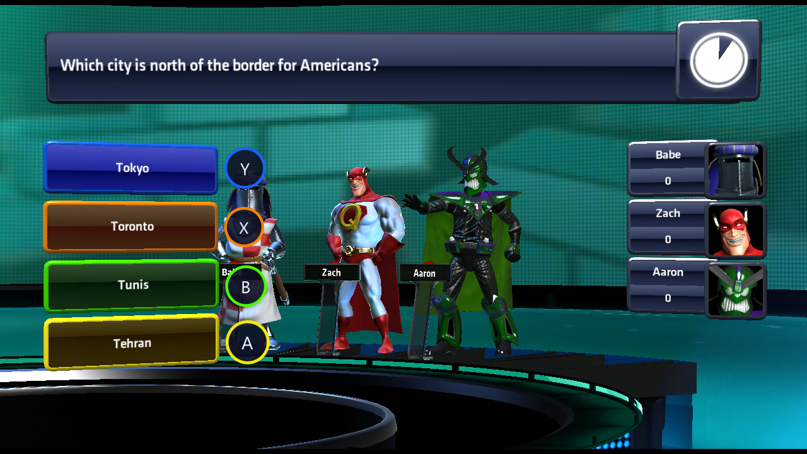
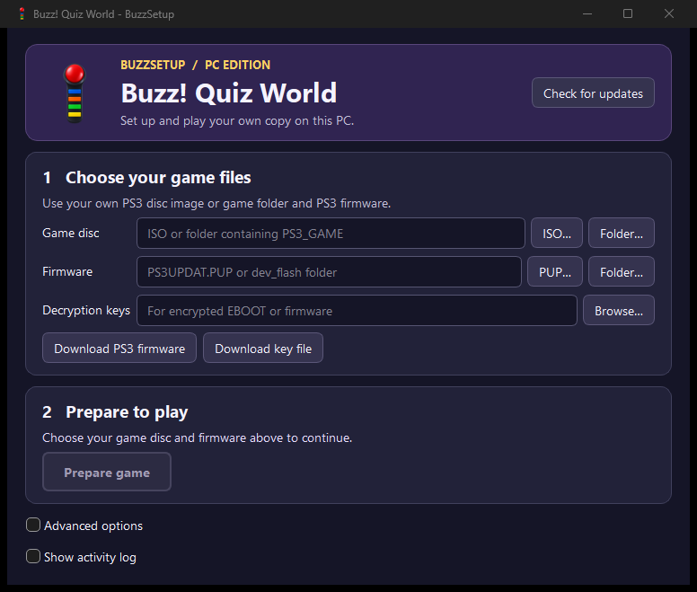
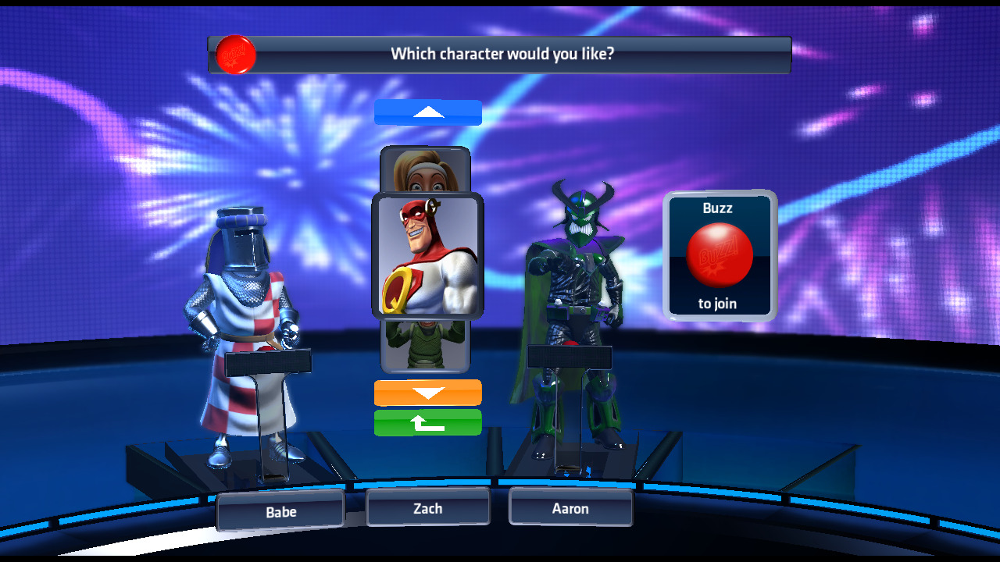
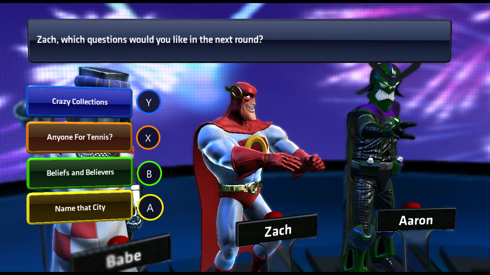
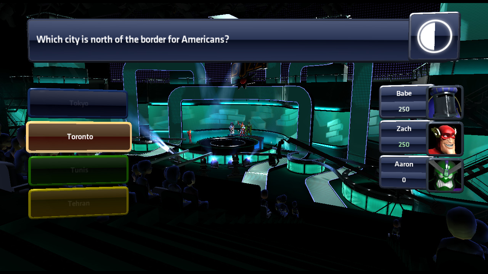
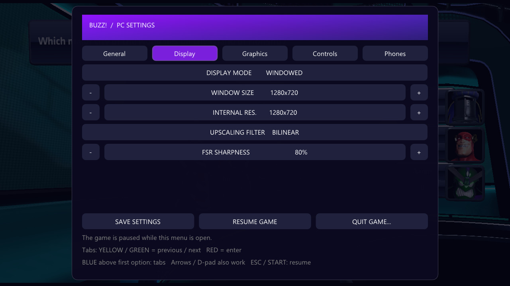
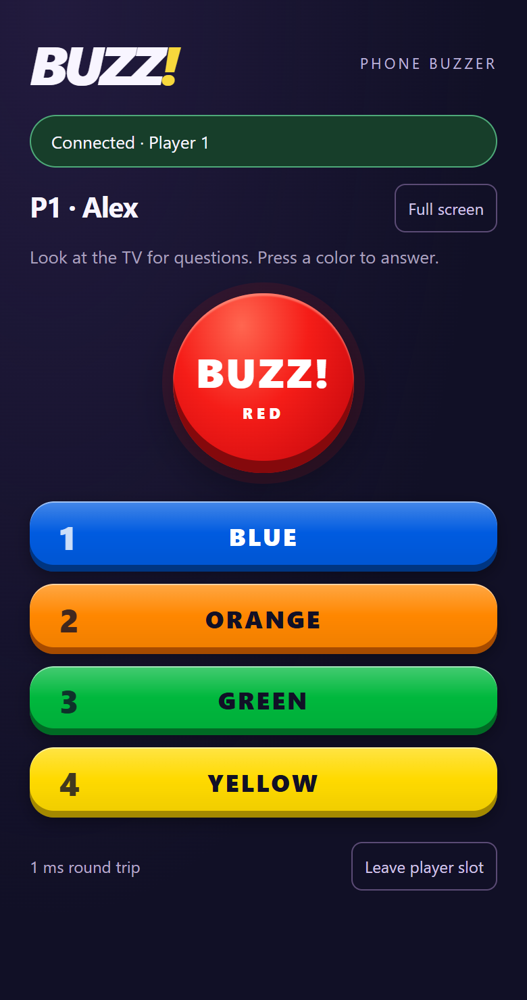

# Buzz! Quiz World Recomp

**Play Buzz! Quiz World on Windows, Linux and Steam Deck.** Take on the quiz solo or gather friends around one screen. Buzz in with a keyboard, a gamepad or a phone on the same Wi-Fi.

[Download BuzzSetup](https://github.com/mario910/buzz-quizworld-recomp/releases/latest) · [How to play](#how-to-play) · [Buzzers and controls](#buzzers-and-controls) · [Question Studio](#question-studio)

> [!IMPORTANT]
> You need your own PS3 copy of **Buzz! Quiz World** and PS3 system software. BuzzSetup prepares a playable copy on your computer using those files. The download contains the setup app and build files. You can set up and play without RPCS3.

## Features

- **Solo and local multiplayer.** Play on one screen without a PlayStation Network account. Friends can join with different types of controllers in the same game.
- **Phones as buzzers.** Scan a QR code to get five Buzz! buttons in your phone's browser.
- **Gamepad button hints.** Xbox and PlayStation button icons appear beside the answers and follow your button layout.
- **Display and audio settings.** Play in a window or fullscreen, change the volume, choose a 30 or 60 FPS limit or go uncapped, and render at up to 4K. AMD FSR 1 and texture packs are optional. [Display and texture guide](docs/pc-settings.md).
- **Custom quizzes.** Write your own quiz with pictures and audio and play it in **Pack Game**. [Question Studio](#question-studio).

## How to play

### What you need

- **Buzz! Quiz World for PS3**, in an ISO disc image or a folder containing `PS3_GAME`. For the best-supported setup, use the original **EU or US 1.00** disc and leave **Game update** empty. [Supported EU discs](docs/disc-100-status.md) · [US disc](docs/us-100-status.md).
- **PS3 system software** as `PS3UPDAT.PUP`, or an existing `dev_flash` folder. BuzzSetup has a **Download PS3 firmware** button that opens the official PlayStation download page.
- **Windows 10/11 or Linux on a 64-bit PC**, including Steam Deck. You need a graphics driver with Vulkan support and a processor with AVX2 and FMA. Allow around **25 GB** for first-time setup.

### 1. Download and open BuzzSetup

**Windows**

1. Download **BuzzPrepare-windows-x64.zip** from the [latest release](https://github.com/mario910/buzz-quizworld-recomp/releases/latest).
2. Extract the whole ZIP to a short, writable path such as `C:\Games\BuzzPrepare`, then open **BuzzSetup.exe** inside the extracted folder.

**Linux and Steam Deck**

1. Download **BuzzSetup-x86_64.AppImage** from the [latest release](https://github.com/mario910/buzz-quizworld-recomp/releases/latest). On Steam Deck, do the first setup in **Desktop Mode**.
2. Right-click the AppImage, open **Properties → Permissions** and mark it executable. Then open it. On Linux, `chmod +x BuzzSetup-x86_64.AppImage` also works. If you prefer an unpacked copy, extract **BuzzPrepare-linux-x86_64.tar.gz** and run **BuzzSetup** inside it.

### 2. Choose your files and prepare the game

1. Under **Game disc**, choose **ISO…** for your disc image or **Folder…** for the folder containing `PS3_GAME`.
2. Under **Firmware**, choose **PUP…** for `PS3UPDAT.PUP` or **Folder…** for `dev_flash`. If your game or firmware files are encrypted, use **Download key file** or **Browse…** to select your own key file. [Game and firmware import guide](docs/game-import.md).
3. If BuzzSetup shows missing tools, follow the buttons it offers. On Windows, select **Desktop development with C++** and a **Windows SDK** in Visual Studio Installer, then return to BuzzSetup and click **Recheck tools**. On Steam Deck, choose **Set up the build container** when prompted. On other supported Linux distributions, choose **Install Linux system tools** if offered. [Linux package and system requirements](preparation/README.md#linux-release-package).
4. Click **Prepare game** and keep BuzzSetup open while it builds your copy. When it says **Ready to play**, click **Play Buzz!**.

### 3. Start a quiz

1. Use **Space** on the keyboard or **LB/RB** on a gamepad as the red buzzer to move through the opening menus. Choose a local game mode.
2. On the player screen, each person presses their red buzzer to join. The game assigns places in the order players press.
3. Load a profile or create one and pick a character, costume and buzzer sound.

*Local multiplayer in the English US 1.00 build on Windows.*

Preparation is a one-time step. Next time, reopen BuzzSetup and click **Play Buzz!**. **Open game folder** takes you to the prepared copy, where you can also start **BuzzQuizWorldRecomp.exe** on Windows.

On Steam Deck, use **Add to Steam** in BuzzSetup, then find the game under **Non-Steam** in Game Mode. If you add the AppImage to Steam yourself, put `--play` in its launch options. The tar package includes `Play-Buzz.sh` for direct launch.

### Pick a subject and score points

In **Standard game**, contestants pick the subjects and Buzz picks the rounds. Use the colored buttons to choose from the subjects on screen.

In **Point Builder**, answer before the timer runs out. The game reveals the correct answer and updates each player's score beside their portrait.

## Buzzers and controls

| Button | Xbox | PlayStation | First keyboard set |
| --- | --- | --- | --- |
| Red buzzer / confirm | LB or RB | L1 or R1 | Space |
| Blue | Y | Triangle | 1 |
| Orange | X | Square | 2 |
| Green | B | Circle | 3 |
| Yellow | A | Cross | 4 |

More keyboard sets are available. Their red buzzers are **Q**, **A** and **Z**, with the next four keys on each row answering blue, orange, green and yellow. Change the bindings under **Controls → Keyboard and pad bindings**. Windows supports Xbox-compatible controllers, DualShock 4 and DualSense. Original USB Buzz! receivers have experimental Windows support. [Input guide](docs/input-and-offline.md) · [Original Buzz! receivers](docs/physical-buzzers.md).

### Change settings mid-game

Press **Esc** or **Start / Options** to pause the game and open PC settings. Use the D-pad to switch tabs or change options. **General** has volume, the frame limit and the performance overlay; **Display** has window size, internal resolution and upscaling. Choose **Save settings** to keep your changes.

### Use your phone as a buzzer

1. Connect the computer and phones to the same local network. The computer can use Ethernet if it shares the phones' network.
2. In the game, open **Esc / Start → Phones**, turn on **Host phone buzzers** and scan the QR code with each phone.
3. On each phone, enter a name and tap **Get ready**. Resume the game, then tap the red buzzer once the game's player screen appears.

[Phone buzzer guide and connection help](docs/phone-buzzers.md).

## Question Studio

Create your own question packs for **Pack Game** with Buzz! Question Studio, a separate Windows and Linux editor. Write questions, preview answers, add pictures and audio, or import questions from supported Buzz! and Knowledge Is Power sources. You can build and install the pack into your prepared game from the editor.

Question Studio is available in current source builds. If your BuzzSetup package includes it, open it with the **Question Studio** button. [Question Studio guide and build instructions](docs/question-studio.md).

## Updates, saves and help

To update a prepared copy, close the game, open BuzzSetup and choose **Update installed game**. Your profiles, saves and controls are kept in the prepared game's `runtime/` folder. To make a backup, locate it with **Open game folder** and copy `runtime/` while the game is closed.

- **Preparation stopped.** In **Advanced options → Resume session**, select the existing session from `build-files/runtime/setup/sessions/` and choose the same inputs again. Enable **Show activity log** to see where setup stopped.
- **BuzzSetup rejects the disc or firmware.** Check that you selected the original EU or US 1.00 disc, the folder containing `PS3_GAME` if using a dump, and the firmware file or folder. Leave **Game update** empty for 1.00. [Input requirements](docs/game-import.md#supported-inputs-and-checks).
- **Keyboard or gamepad does nothing.** Click the game window and check the bindings in the PC settings. On the player screen, press a buzzer button to join.
- **The phone page does not open.** Make sure the phones can reach the computer on the same network and allow the game through the firewall on your private network. [Phone connection help](docs/phone-buzzers.md).

Local play is supported. PSN and MyBuzz are unavailable. Performance varies by hardware and scene, and original Buzz! receivers and larger multiplayer sessions still need more testing. The Android build is a work in progress. [Android development guide](android/README.md).

If you run into a problem, include your OS, game region, BuzzSetup version and the steps to reproduce it. For setup failures, include the relevant lines from **Show activity log**. Remove personal paths before sharing. [Report an issue](https://github.com/mario910/buzz-quizworld-recomp/issues).

## For developers

The project uses [PS3Recomp](https://github.com/sp00nznet/ps3recomp) and pins the [Buzz SDK fork](https://github.com/mario910/ps3recomp). [Build from source](docs/development.md#build-from-source) · [Command-line preparation](docs/game-import.md) · [Documentation](docs/README.md) · [Release notes](docs/releases/README.md) · [Contributing](CONTRIBUTING.md).

Thanks to Ned Heller / sp00nznet and the PS3Recomp contributors, and to the FFmpeg, PPSSPP, stb and zlib authors. Buzz! and PlayStation are trademarks of their respective owners. This is an unofficial project independent of Sony and Relentless Software. The repository's MIT license covers its source code. Your locally built game contains material under separate licenses. [Third-party notices](THIRD_PARTY_NOTICES.md).
