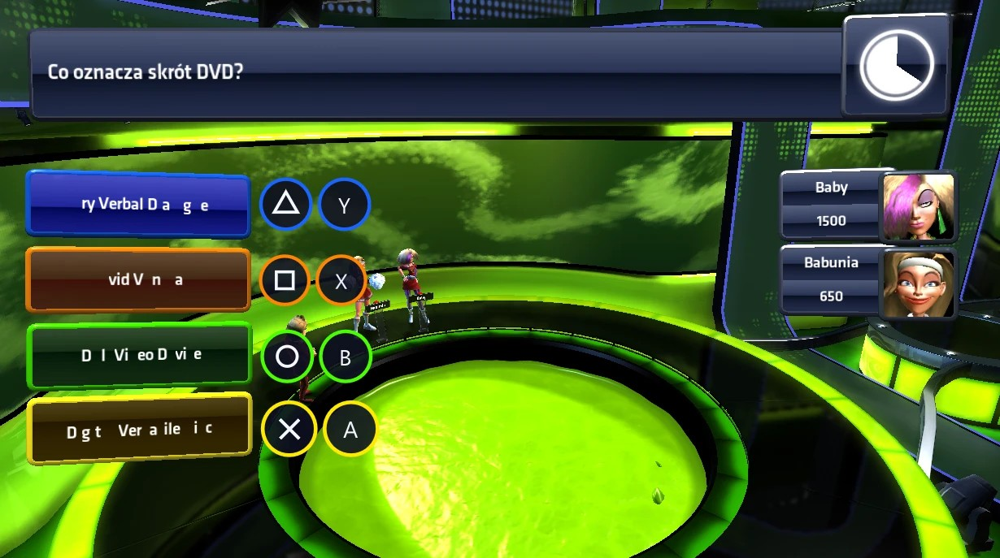

## What's new in v0.3.7

### PlayStation controllers and button hints

- **DualShock 4 and DualSense work on Windows** out of the box, over USB or
  Bluetooth, next to Xbox (XInput) controllers. No DS4Windows or Steam Input
  needed.
- **Button hints on the answers.** Each answer board shows the controller
  button that picks it: △ □ ○ ✕ for PlayStation pads, Y X B A for Xbox pads,
  both when both kinds are connected. The icons follow the boards and your own
  button layout. Switch them off in **Esc → Controls → Button hints on
  answers** (Vulkan renderer).
- **New default layout, as in RPCS3 and PCSX2:** red buzzer on **L1 or R1**
  (LB/RB), and the face buttons in the handset's order from top to bottom:
  Triangle/Y blue, Square/X orange, Circle/B green, Cross/A yellow. Options /
  START opens the PC menu.
- **One button layout for all controllers**, set in **Esc → Controls →
  Keyboard and pad bindings → Gamepads** or in the launcher's Controls tab.
  Layouts you never changed move to the new default automatically; custom
  ones are kept.

### Joining a game

- **Players join on the game's own player screen.** Keyboard key sets,
  controllers and phones no longer have a fixed player: the first press on the
  player screen takes the next free place and joins it, in press order. Before
  that, the keyboard or any controller drives the menus (for example the
  language choice).
- Places that did not join are freed when the player screen closes, and a
  player whose phone left or lost its session is taken over by the next device
  that presses a button, even mid-game.
- Gamepad support is always on; the old on/off switch and the per-controller
  player assignment are gone.

### Phone buzzers

- **No pairing code any more.** Phones join from the game's plain local
  address, so a bookmark on the phone works every time (the QR code still
  works too).
- **Get ready, then join on the player screen:** any number of phones can wait,
  and the first ones to press take the free places. The others are told that
  all players are in.
- Turning phone buzzers on is remembered for the next start.

### Notes

- Older settings files keep working: per-controller players are dropped and
  the first controller's buttons become the shared layout.
- If a tool such as DS4Windows adds a virtual Xbox pad without hiding the real
  one, one controller shows up twice. Hide the real pad there, or start the
  game with `BUZZ_SONY_PADS=0`.
