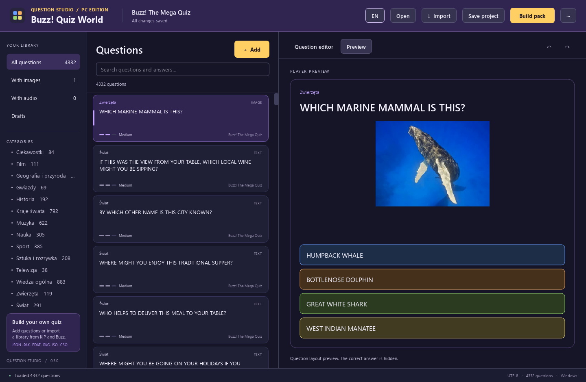

## What's new in v0.3.8

### Installation fixes

- **Preparation works in longer install folders.** It no longer stops with
  `Build step for ps3_vk_headers failed` when the game lives in a deeper
  folder, such as a RecompLauncher library on another drive. The Windows
  build now nests far fewer folders below your install location.
- **A clear message instead of a CMake error.** If the folder is still too
  long for Windows, BuzzSetup says so before building, tells you by how many
  characters, and suggests a shorter place such as `C:\Games\Buzz`.
- **BuzzSetup closes once the game has started.**

If an earlier version failed with the `ps3_vk_headers` error, start a **new**
preparation rather than resuming the old session.

### Question Studio ships with BuzzSetup

Make your own quiz packs or edit existing questions, then install them into
your game. Open it with the new **Question Studio** button in BuzzSetup; it is
included in the Windows ZIP, the Linux package and the AppImage.

- **A new interface** in the same style as BuzzSetup.
- **Import from every Buzz! game, without Python:** PS2 Mega Quiz (with its
  pictures and video clips) and Hollywood Quiz, PSP Master Quiz and
  other PSP editions, PS3 discs, PSN packages and EDAT/SDAT files, DLC you own
  (with your `.rap` license), and Knowledge Is Power.
- **Your own categories,** such as "Harry Potter" or "Christmas", named in
  each language of the pack. Pack titles and descriptions are per language
  too.
- **Question videos with sound** play in your packs. Short clips are
  converted for the game when you build the pack (FFmpeg is needed only in
  Question Studio, not in the game).
- **Portable projects:** a project is a folder with its pictures, speech and
  videos, and a `.buzzproject` file moves it to another computer.

### In the game

- **The buzzer test with two sets of buzzers** (eight players) now also shows
  how to leave the test, next to the game's two-sets warning.

### Removed

- **The old launchers are gone:** the separate BuzzLauncher window, the
  Python launcher, and on Linux `--launcher` / `Buzz-Launcher.sh`. Start the
  game with **Play Buzz!** in BuzzSetup, and change controls, phones, display
  and texture packs in the in-game menu (**Esc** or **START**).

### Updating

Open BuzzSetup and choose **Update installed game**. Your saves, profiles and
controls in `dist/runtime/` are kept.
